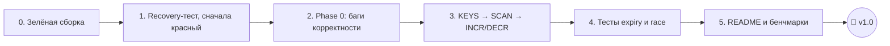

# 🗄️ in-memory-key-value-db: дорожная карта к v1.0

> Redis-подобная in-memory KV база на Go: шардированный движок с LRU, WAL с group commit, снапшоты, TTL.
>
> **Определение «готово» для v1.0 зафиксировано 2026-10-03.**
> **Ревью кода и пересмотр плана: 2026-10-11.**
> Tier 3 (RESP, Pub/Sub, репликация) относится к **v2** и в v1.0 не входит.

---

## 📍 Текущее состояние

| Подсистема | Статус | Комментарий |
|---|---|---|
| Шардированный движок (murmur2 + RWMutex на партицию) | ✅ | |
| LRU-вытеснение по лимиту памяти | ✅ | ⚠️ держит lock во время fsync, см. **B4** |
| WAL (batch + fsync + сегменты) | ✅ | ⚠️ порядок записи в WAL ≠ порядок применения, см. **B6** |
| Snapshot (JSON, атомарный rename) | ✅ | ⚠️ после рестарта данные теряются, см. **B2** |
| TTL / expiry | ✅ | ⚠️ три бага, см. **B5** |
| Graceful shutdown | ⚠️ | паника `send on closed channel`, см. **B3** |
| `KEYS` | 🚧 | объявлена, но в `compute.go` нет `case` |
| `SCAN` | 🚧 | в storage и engine `panic("not implemented")` |
| `INCR` / `DECR` | ⬜ | |
| Тесты надёжности | ⬜ | |
| `go build ./...` | ❌ | `semaphore.go` в корне: `package main` без `main()` |
| README | ⬜ | |

---

## 🧭 Рекомендуемый порядок работы



> 💡 **Совет ментора.** Не бери новые фичи, пока база теряет данные. Пользователь простит отсутствие `SCAN`,
> но не простит потерю записи, на которую он получил `OK`. Порядок такой: **сначала корректность, потом фичи,
> потом документация.**

---

## ✅ Definition of Done для v1.0

- [ ] `go build ./...`, `go vet ./...`, `go test -race ./...` проходят без ошибок
- [ ] Все баги из **Phase 0** закрыты, и на каждый есть регрессионный тест
- [ ] Работают `KEYS`, `SCAN`, `INCR`, `DECR`, все покрыты тестами
- [ ] Recovery-тест проходит: запись → крэш → рестарт → данные на месте (несколько циклов подряд)
- [ ] Expiry-тест проходит: ключ с TTL исчезает, ключ без TTL живёт, перезапись без TTL снимает TTL
- [ ] README: архитектура, запуск, протокол, честные бенчмарки, известные ограничения

---

## 0️⃣ Зелёная сборка

- [ ] **0.1** Убрать `semaphore.go` из корня. Сейчас `go build ./...` падает с ошибкой `function main is undeclared in the main package`.
  - Это учебный файл, к тому же он в `.gitignore`. Перенеси его в `internal/pkg/semaphore/` (поменяй `package`) или удали.
- [ ] **0.2** Удалить или заполнить пустые `test/load/load_test.go` и `test/load/scenarios.go`
- [ ] **0.3** Добавить в `Makefile` цель `check: vet test-race` и запускать её перед каждым коммитом

---

## 🚨 Phase 0: баги корректности (блокеры v1.0)

> Найдены на ревью 2026-10-11. **B1** и **B2** воспроизведены вживую.
> Правило: **на каждый баг сначала пишем падающий тест, потом чиним.**

### B1. 💀 Дедлок на старте при WAL больше 100 SET-ов (воспроизведено)

- [ ] Исправлено, тест есть

**Симптом.** Если в WAL лежит больше 100 команд `SET`, сервер при старте зависает и не открывает порт.

**Причина.** `walLog.restoreBatch()` на каждый `SET` (даже с TTL=0) отправляет событие в `expiryEvent`.
У канала буфер 100, а читатель `expiryWorker.Run()` запускается в `main.go` **после** `walLog.NewWAL()`.
Сто первая отправка блокируется навсегда.

<details>
<summary>💡 Подсказка ментора</summary>

- Общий принцип: **recovery должен быть синхронным и не зависеть от фоновых горутин.** Восстановление — это
  чистая функция «файлы на диске → состояние в памяти».
- Второй принцип: **потребителя запускают раньше производителя.** Это правило инициализации.
- Правильный фикс получится сам собой, когда сделаешь **B5**: TTL станет полем `expireAt` в `Elem`, и
  `restore` будет просто вызывать `engine.Set(key, value, expireAt)` без всяких каналов.
- Попутно: если при restore объём данных превысит лимит, `evictIfNeeded` попробует писать в `walEvents`,
  а WAL-воркер ещё не запущен. Это второй дедлок того же типа. Вытеснение во время recovery надо отключить.

</details>

---

### B2. 💀 Потеря данных после двух рестартов подряд (воспроизведено)

- [ ] Исправлено, тест есть

**Сценарий:**
1. `SET k1 v1` → запись в WAL → `kill -9`
2. Рестарт: WAL проигран, `GET k1` → `v1` ✅, **сегменты WAL удалены** (`defer` в `restoreBatch`)
3. Снапшот ещё не сделан (restore не увеличивает `changesCnt`) → `kill -9`
4. Рестарт: `GET k1` → `key not found` ❌

**Причина.** Сегменты WAL удаляются сразу после replay, хотя их содержимое ещё нигде не сохранено.
Плюс: «усечение WAL после снапшота», которое в старом todo помечено как DONE, на самом деле не реализовано.
После `Dump()` WAL только флашится, старые сегменты продолжают копиться до рестарта.

<details>
<summary>💡 Подсказка ментора: правильный протокол checkpoint</summary>

Главный инвариант: **удалять сегмент WAL можно только когда его содержимое гарантированно лежит в
снапшоте на диске (после fsync и rename).**

Протокол «fuzzy snapshot»:
1. **Rotate** WAL. Новые записи пойдут в сегмент `N+1`. Запоминаем `N` как checkpoint.
2. **Dump** всех партиций (можно параллельно, как сейчас). Снапшот будет «размытым»: часть записей из
   `N+1` в него попадёт, часть нет. **Это нормально.**
3. В снапшот пишем метаданные `{"wal_segment": N+1, ...}`.
4. `fsync` → `rename` (это у тебя уже правильно).
5. Только теперь **удаляем сегменты ≤ N**.

На старте:
1. Загрузить снапшот, прочитать `wal_segment`.
2. Проиграть **все** сегменты `≥ wal_segment` по порядку.
3. Сегменты на старте **не удалять**.

Почему повторный replay безопасен: `SET` и `DEL` **идемпотентны**. Повторное применение даёт тот же
результат. Запомни это свойство, оно понадобится в задаче про `INCR`.

Ещё два момента:
- Имена сегментов сейчас строятся по `time.Now().UnixMilli()`. Две ротации в одну миллисекунду дадут
  коллизию, а перевод часов назад сломает порядок. Используй монотонный счётчик:
  `segment_000000000042.log` (с ведущими нулями, чтобы лексикографическая сортировка совпадала с числовой).
- `os.ReadDir` возвращает файлы, отсортированные по имени. Сейчас на этом держится порядок replay.
  Сделай это явным (`sort`) и игнорируй посторонние файлы вроде `.DS_Store`.

</details>

---

### B3. 💥 Graceful shutdown паникует

- [ ] Исправлено, тест есть

**Причина.** Горутина обработки сигнала делает `close(walEvents)`, `close(changeChan)` и другие закрытия,
а TCP-хендлеры в этот момент ещё могут выполнять `Compute.Handle` и писать в эти каналы. Итог:
`panic: send on closed channel`. Кроме того, `deleteLeastActive` ждёт `<-done` от WAL-воркера, который уже
вышел по `ctx.Done()`. Такая горутина висит вечно.

<details>
<summary>💡 Подсказка ментора</summary>

- Правило Go: **канал закрывает только отправитель и только когда отправителей больше не осталось.**
  Если отправителей много (а у тебя это все TCP-соединения), канал вообще не закрывают. Останавливаются через `ctx`.
- Shutdown должен идти в порядке, **обратном** зависимостям:
  1. Перестать принимать соединения, дождаться in-flight запросов (`wg.Wait()` в сервере у тебя уже есть).
  2. Остановить фоновые воркеры, которые пишут в WAL: eviction, expiry, snapshot.
  3. Финальный flush WAL, `fsync`, `close`.
  4. (Опционально) финальный снапшот.
- Один `ctx` на всё не подходит, потому что он гасит всех одновременно. Нужна явная последовательность в
  `main`. Ещё лучше вынести её в `db.Close()`.

</details>

---

### B4. 🐌 Вытеснение держит lock партиции, пока ждёт fsync

- [ ] Исправлено

**Причина.** `evictIfNeeded` берёт `p.mu.Lock()` и внутри `deleteLeastActive` ждёт `<-done` от WAL.
Это до `flushing_batch_timeout` плюс fsync **на каждую жертву**. Всё это время партиция заблокирована
для всех `GET` и `SET`.
Заодно: если WAL ошибается 6 раз подряд, внешний `for p.used > p.limit` крутится **бесконечно** под локом.

<details>
<summary>💡 Подсказка ментора</summary>

- Правило: **никакого I/O и никакого ожидания других горутин под мьютексом.**
- Под локом: собрать жертв, удалить их из `map` и списка, обновить `used`. Отпустить лок.
  После этого отправить tombstone-записи в WAL.
- Вместо retry-цикла: залогировать ошибку и `break`. Следующий тик попробует снова.
- Порядок «сначала удалили из памяти, потом записали в WAL» здесь допустим: вытеснение — это решение
  кэша, а не клиентская операция, ответа `OK` никто не ждёт.

</details>

---

### B5. ⏱️ TTL работает неправильно (три бага)

- [ ] Исправлено, тесты есть

1. **Старый таймер убивает новое значение.** `SET k v1 10`, затем `SET k v2` без TTL. Через 10 секунд
   `time.AfterFunc` удалит `k`, хотя у `v2` TTL нет.
2. **TTL не попадает в снапшот.** В `dump.json` лежит только `key → value`. После рестарта со снапшота
   все ключи с TTL становятся вечными.
3. **TTL в WAL записан относительно.** `SET k v 30` при replay через час снова даст 30 секунд жизни.
   Ключ, который давно должен был умереть, оживает.

Ещё мелочи: в `Compute.Handle` для `SET` событие expiry отправляется **до** записи в WAL (если WAL упадёт,
таймер всё равно сработает), а `changeChan <- struct{}{}` отправляется до валидации TTL.

<details>
<summary>💡 Подсказка ментора: как устроено в Redis</summary>

TTL — это **данные**, а не таймер.

```go
type Elem struct {
    key, value string
    expireAt   int64 // unix nano, 0 = без TTL
    // ...
}
```

- **Lazy expiry:** `Get` проверяет `expireAt` и, если срок истёк, удаляет ключ и возвращает miss.
- **Active expiry:** у каждой партиции уже есть тикер (`checkPartitionLimit`). Добавь туда очистку.
  Держи отдельный `map[string]struct{}` ключей с TTL и проверяй по 20 случайных за тик, как в Redis.
- `SET` без TTL пишет `expireAt = 0`, это и снимает TTL. Баг 1 исчезает сам.
- WAL и снапшот хранят **абсолютное** время: `SET k v PXAT 1791234567890`. Баги 2 и 3 исчезают.
- Пакет `expiry` с `AfterFunc` и каналом `expiryEvent` удаляется целиком, а с ним уходит причина **B1**.
- Для тестов внедри часы: `now func() time.Time`. **Никаких `time.Sleep` в тестах.**

</details>

---

### B6. 🔀 Порядок в WAL не совпадает с порядком применения

- [ ] Исправлено, тест есть

**Сценарий.** Два клиента одновременно выполняют `SET x 1` и `SET x 2`.
`Compute` сначала пишет в WAL, потом вызывает `storage.Set`, и между этими шагами нет общего лока.
Возможен порядок: в WAL `1, 2`, в памяти `2, 1`. Живая база отдаёт `x = 1`, после рестарта `x = 2`.
**Реплей даёт не то состояние, которое видели клиенты.**

<details>
<summary>💡 Подсказка ментора</summary>

Инвариант WAL: **порядок записей в логе = порядок применения изменений к одному ключу.**

Решение: применение и постановка записи в очередь WAL выполняются **под одним локом партиции**,
а ожидание fsync идёт **после** отпускания лока:

```go
p.mu.Lock()
// 1. применить изменение в памяти
// 2. поставить запись в очередь WAL (неблокирующе, только append в упорядоченную очередь)
done := walLog.Enqueue(record)
p.mu.Unlock()
// 3. ждать fsync уже без лока
if err := <-done; err != nil { ... }
// 4. только теперь ответить клиенту OK
```

Это group commit с правильным порядком. Компромисс: другие читатели могут увидеть значение до fsync.
Redis делает так же, и для v1 это допустимо. Опиши это в README в разделе «Гарантии».

Этот рефакторинг готовит почву для `INCR` (см. 3.3). Делай их вместе.

</details>

---

### B7. 📝 Известные ограничения формата (чинить в v1 не обязательно, но описать в README)

- [ ] Описано в README

- Значения не могут содержать пробелы и переводы строк: `strings.Fields` в парсере и текстовый формат WAL.
  Это решит RESP в v2.
- В WAL нет контрольных сумм. Оборванная последняя строка после крэша сейчас молча пропускается
  (`len(query) < 4 → continue`), а битые байты в середине файла не обнаружатся.
  Решение для v2: длина + CRC32 на каждую запись.
- Синтаксис в старом todo был `SET key value EX 30`, а парсер принимает `SET key value 30`. Выбери один
  вариант. Если делаешь RESP в v2, бери Redis-синтаксис `EX` / `PX` / `PXAT`.

---

## 1️⃣ Фичи

### 1.1 `KEYS pattern`

- [ ] `case KeysCommand` в `compute.go`
- [ ] Метод движка: обойти все партиции под `RLock`, отфильтровать по glob
- [ ] Формат многострочного ответа (см. подсказку)
- [ ] Табличные тесты на glob: `*`, `?`, `[abc]`, `[a-z]`, `\*`, пустой паттерн, ключи с `/`

<details>
<summary>💡 Подсказка ментора</summary>

- ⚠️ `path.Match` **не подходит**: в нём `*` не матчит `/`, а Redis-glob матчит. Ключ `user/1` не найдётся
  по `user*`. Напиши свой матчер (около 50 строк). Это отличное упражнение для табличных тестов.
- `Get` берёт полный `Lock`, потому что двигает LRU. `KEYS` только читает, ему хватит `RLock`. Не двигай
  LRU при `KEYS`, иначе любой `KEYS *` сделает все ключи «свежими».
- Учти просроченные ключи (после **B5**): их возвращать нельзя.
- **Протокол.** Сейчас ответ — одна строка до `\n`. Список так не передать. Минимальное решение, совместимое
  с будущим RESP: заголовок `*<N>\n`, затем N строк. Не забудь обновить CLI-клиент.
- Документируй, что `KEYS` работает за O(N) и по очереди блокирует каждую партицию. Именно поэтому есть `SCAN`.

</details>

### 1.2 `SCAN cursor [MATCH pattern] [COUNT n]`

- [ ] Парсер: опциональные `MATCH` / `COUNT` в любом порядке (arity для `SCAN` станет `{1, 5}`)
- [ ] Убрать `panic("not implemented")` из `storage.go` и движка
- [ ] Новая сигнатура: `Scan(cursor string, match string, count int) (next string, keys []string, err error)`
- [ ] Тесты: полный обход возвращает каждый ключ ровно один раз; `COUNT` соблюдается; некорректный курсор → ошибка

<details>
<summary>💡 Подсказка ментора: дизайн курсора</summary>

Go-мапы не дают доступа к бакетам, поэтому трюк Redis (reverse binary iteration по хеш-таблице)
не повторить. Почитай про него для общего развития, но здесь подойдёт свой дизайн:

**Курсор = (индекс партиции, последний выданный ключ).**

- Внутри партиции под `RLock` собираешь ключи `> lastKey`, подходящие под `MATCH`, и берёшь `COUNT`
  наименьших (сортировка или heap). Когда партиция закончилась, переходишь к `idx + 1` с `lastKey = ""`.
- Курсор кодируется в непрозрачную строку (например, base64url от `idx:lastKey`). `"0"` означает и начало,
  и конец обхода.
- **Гарантии** (их нужно записать в README): ключ, который существовал на протяжении всего обхода, будет
  возвращён **ровно один раз**. Ключи, добавленные или удалённые во время обхода, могут вернуться, а могут нет.
  Глобальной блокировки нет, в каждый момент заблокирована максимум одна партиция.
- Цена: каждый вызов O(размер партиции · log COUNT). Для v1 это приемлемо, запиши это в ограничения.
- ⚠️ Число партиций = `runtime.NumCPU()`. Если сервер перезапустится на машине с другим числом ядер,
  старые курсоры станут невалидными. Это нормально, но стоит добавить в курсор версию или число партиций.

</details>

### 1.3 `INCR key` / `DECR key`

- [ ] Атомарный read-modify-write в движке
- [ ] В WAL пишется **результат** (`SET key 42 ...`), а не команда `INCR`
- [ ] TTL ключа сохраняется (так в Redis)
- [ ] Тесты: несуществующий ключ → `1`; не число → ошибка; переполнение `int64` → ошибка;
      **1000 горутин × 1000 INCR = 1 000 000** (с `-race`)

<details>
<summary>💡 Подсказка ментора</summary>

- Сделай одну обобщённую операцию в движке, а не отдельные `Incr` и `Decr`:
  ```go
  Update(key string, fn func(old string, exists bool) (string, error)) (string, error)
  ```
  `fn` выполняется под локом партиции. Через `Update` реализуются `INCR`, `DECR`, `INCRBY`, `APPEND` и другие.
- **Почему в WAL нельзя писать `INCR`:** операция не идемпотентна. Помнишь fuzzy snapshot из **B2**?
  Если `INCR` попадёт и в снапшот, и в replay, значение увеличится дважды. `SET x 42` безопасно применять
  сколько угодно раз.
- Переполнение: `strconv.ParseInt(old, 10, 64)`, затем проверка `n == math.MaxInt64` перед `+1`.
- Порядок «применить → поставить в WAL → отпустить лок → ждать fsync» тот же, что в **B6**.

</details>

---

## 2️⃣ Тесты надёжности

> 💡 **Совет ментора.** Главная проблема сейчас в том, что `cmd/server/main.go` собирает всю систему вручную,
> и протестировать её можно только запуском бинарника. Вынеси сборку в
> `internal/database/db.go`:
> ```go
> db, err := database.Open(cfg)   // load snapshot + replay WAL + start workers
> db.Handle("SET k v")
> db.Close()                      // упорядоченный shutdown (B3)
> ```
> После этого `main.go` занимает 20 строк, а recovery-тест превращается в обычный `go test` с `t.TempDir()`.

- [ ] **2.1 Recovery (unit, с `t.TempDir()`)**
  - [ ] запись → `Close()` → `Open()` → данные на месте
  - [ ] запись → «крэш» (бросить `db` без `Close`, только с дождавшимся fsync) → `Open()` → данные на месте
  - [ ] **три рестарта подряд без новых записей** → данные на месте (ловит **B2**)
  - [ ] больше 100 записей в WAL → `Open()` завершается (ловит **B1**, ставь таймаут)
  - [ ] снапшот + хвост WAL → состояние = снапшот + хвост
  - [ ] `DEL` после `SET` в WAL → ключа нет после рестарта
- [ ] **2.2 Crash e2e (`make crash-test`)**: собрать бинарник, писать в цикле, `kill -9`, поднять, сверить.
      Всё, на что пришёл `OK`, обязано быть на месте.
- [ ] **2.3 Expiry** (с фейковыми часами)
  - [ ] ключ с TTL исчезает после срока, ключ без TTL живёт
  - [ ] `SET k v 10` → `SET k v2` → через 11 секунд ключ жив (ловит **B5.1**)
  - [ ] TTL переживает рестарт через снапшот и через WAL (ловит **B5.2**, **B5.3**)
  - [ ] просроченный ключ не возвращается из `GET`, `KEYS`, `SCAN` даже до active-очистки
- [ ] **2.4 Конкурентность**: `go test -race ./...` на параллельных `SET`/`GET`/`DEL`/`INCR`/`SCAN` + eviction
- [ ] **2.5 Shutdown**: `Close()` во время нагрузки не паникует и не виснет (ловит **B3**)

---

## 3️⃣ README

- [ ] Что это и зачем (2–3 предложения)
- [ ] Архитектура: mermaid-схема `TCP → Parser → Compute → Engine (N партиций + LRU) → WAL / Snapshot`
- [ ] Путь записи: применить → WAL → group commit → fsync → `OK`
- [ ] Путь recovery: снапшот + replay хвоста WAL, почему это безопасно (идемпотентность)
- [ ] Запуск: `make build`, `./bin/server -config config.yaml`, `./bin/cli`, описание всех полей `config.yaml`
- [ ] Протокол: список команд с примерами
- [ ] **Гарантии и ограничения**: durability, видимость незафиксированных записей, семантика `SCAN`, **B7**
- [ ] **Бенчмарки, честно** (см. ниже)

> 💡 **Про бенчмарки.** По твоему `res.txt` при 50% записей `sync.Map` быстрее по latency
> (~51 ns/op против ~104 ns/op), но тратит 3 аллокации и 55 B/op против 1 аллокации и 15 B/op у партиций.
> Главное: у `sync.Map` нет лимита памяти и LRU, поэтому сравнение не равноценное. Так и напиши:
> *«sync.Map быстрее на голых операциях, но не умеет вытеснение. Шардированный движок платит ~2× latency
> за предсказуемую память и LRU».* Честный trade-off на собеседовании ценится выше, чем «моё решение
> быстрее всех». Добавь таблицы для 1%, 10% и 90% записей.

---

## 🏆 Сделано (архив Tier 1–2)

<details>
<summary>✅ TTL / expiry для ключей</summary>

`SET key value 30`: ключ живёт 30 секунд, потом удаляется.
⚠️ Требует переделки, см. **B5**.

</details>

<details>
<summary>✅ Шардированная мапа вместо одного <code>sync.RWMutex</code></summary>

Партиционирование по `murmur2(key) % NumCPU`, у каждой партиции свой `RWMutex`.

**Запуск бенчмарков:**

```bash
go test -bench=BenchmarkMixed_ByWritePct -benchmem -count=10 -cpu=10 ./internal/database/storage/in_memory > res.txt
benchstat res.txt
```

**Как читать строку:**

```
BenchmarkMixed_ByWritePct/sync/writes=50%-10   24469903   53.31 ns/op   55 B/op   3 allocs/op
```

| Поле | Значение |
|---|---|
| `writes=50%` | доля операций записи |
| `-10` | `GOMAXPROCS` (число ядер) |
| `24469903` | сколько раз выполнилось тело бенчмарка |
| `53.31 ns/op` | latency одной операции, меньше = лучше |
| `55 B/op` | байт аллоцировано на куче за операцию |
| `3 allocs/op` | число аллокаций на куче за операцию |

**Вывод:** `sync.Map` быстрее по latency, но без ограничений копит память и не поддерживает LRU.
Шардированный движок экономнее по памяти и аллокациям и умеет вытеснение.

</details>

<details>
<summary>✅ Snapshot (checkpoint) + усечение WAL</summary>

Периодический снапшот всего состояния (JSON, `tmp → fsync → rename`) по правилам `save` из конфига.
⚠️ Усечение WAL после снапшота фактически не реализовано, а восстановление теряет данные, см. **B2**.

</details>

<details>
<summary>✅ LRU-вытеснение при лимите памяти</summary>

Двусвязный список на партицию: `Get`/`Set` двигают элемент в хвост, фоновый воркер раз в 500 мс
вытесняет элементы с головы, пока `used > limit`, и пишет tombstone в WAL.
⚠️ Держит лок во время ожидания WAL, см. **B4**.

</details>

---

## 🔭 Backlog v2 (Tier 3, в v1.0 не входит)

### RESP-протокол
Redis Serialization Protocol. С ним к базе подключается `redis-cli` и любой Redis-клиент.
Учит чтению спецификации, wire protocol и бинарному парсингу. Заодно снимает ограничение на пробелы в значениях (**B7**).

### Pub/Sub
`SUBSCRIBE channel` / `PUBLISH channel message`. Учит fan-out через каналы, управлению подписчиками
и обработке медленных подписчиков (что делать, когда буфер полон).

### Репликация (Leader → Follower)
Follower получает поток WAL от лидера и проигрывает его. Здесь пригодится всё, что сделано в v1:
идемпотентные записи, номера сегментов и offset'ы, снапшот для начальной синхронизации.

### Идеи сверху
- CRC32 на записи WAL и обнаружение повреждений
- Бинарный формат снапшота (`encoding/gob` или свой) вместо JSON
- Approximate LRU (сэмплирование, как в Redis), чтобы `GET` работал под `RLock`
- Метрики (Prometheus): ops/s, hit rate, размер WAL, длительность fsync

---

## 📏 Правила работы

1. **Одна задача = одна ветка = один PR.** Сообщения коммитов в формате `fix(walLog): ...`, `feat(compute): KEYS`, `test(recovery): ...`
2. **Баг сначала воспроизводится тестом.** Красный → зелёный → рефакторинг.
3. **`make check` перед каждым коммитом.** `-race` обязателен, в базе много горутин.
4. **Никакого I/O и ожидания каналов под мьютексом.** Это источник половины багов выше.
5. **Каждый новый инвариант записывается.** Комментарий в коде или раздел «Гарантии» в README.
   Если не можешь сформулировать гарантию, значит, её нет.
